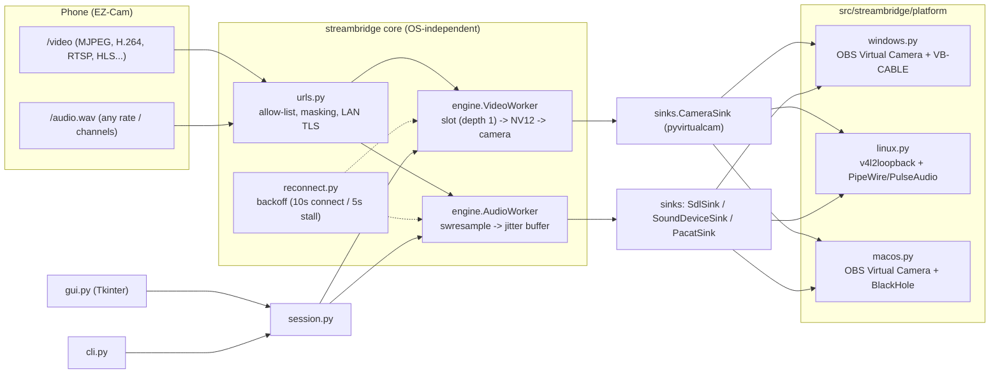

# StreamBridge Architecture



---

## 1. Core Subsystems

| Module | Responsibility | Key Invariants |
| :--- | :--- | :--- |
| **`session.py`** | Coordinates lifecycle of video & audio workers from `Options`. | Joins worker and sender threads against a shared **~2 s deadline** (`STOP_TIMEOUT_S`) before tearing down microphone sinks. |
| **`engine.py`** | Decodes media streams via PyAV, formats frames, manages output. | Never blocks decoder threads on device output. Pushes black frames during reconnection so applications don't drop the camera. |
| **`urls.py`** | Sanitizes, normalizes, and validates user stream endpoints. | Scheme allow-list; strictly masks credentials in logs and UI; enforces public TLS while accepting LAN self-signed certs. |
| **`logging_setup.py`** | Centralizes logging configuration and log directory management. | Front-end agnostic (`cli.py`, `gui.py`, and `settings.py` share it without circular dependencies); always filters out credentials. |
| **`settings.py`** | Persists configuration and recent history. | Writes atomically via temporary file + `fsync` + `os.replace` to prevent corrupted state on sudden termination. |

---

## 2. Platform Adapters (`src/streambridge/platform/`)

All OS-specific logic is strictly isolated in `platform/` under a common `Platform` interface (`check()`, `mic_setup()`, `mic_teardown()`, `camera_backend`, `audio_outputs()`).

| Platform | Virtual Camera Target | Virtual Microphone Target | Primary Audio Sink |
| :--- | :--- | :--- | :--- |
| **Windows** | OBS Virtual Camera (`obs`) | VB-CABLE (`CABLE Input` / `CABLE Output`) | `sdl_audio.SdlSink` (SDL2 WASAPI shared); fallback to `SoundDeviceSink` (MME) |
| **Linux** | StreamBridge Camera (`v4l2loopback`) | StreamBridge Microphone (`streambridge_mic`) | `sinks.PacatSink` (pacat into `module-null-sink` / `module-remap-source`) |
| **macOS** | OBS Virtual Camera (`obs`) | BlackHole 2ch (`BlackHole`) | `sinks.SoundDeviceSink` (PortAudio Core Audio) |

> [!NOTE]
> StreamBridge never requires administrator / root privileges. On Linux, it temporarily loads two user-space PulseAudio/PipeWire modules (`streambridge_out` and `streambridge_mic`) and cleans them up symmetrically on exit.

---

## 3. Low-Latency Engineering Principles

StreamBridge enforces minimal end-to-end latency without unbounded buffering:

1. **Strict Queue Caps (Zero Delay Accumulation):**
   - **Video:** Depth-1 latest-frame slot. Decoded frames are dropped if the virtual camera backend is temporarily slower, preventing video delay from accumulating.
   - **Audio:** A single ring jitter buffer (`jitter.py`). Oldest audio is pruned when exceeding threshold; clock drift is dynamically smoothed by 1–2 samples per block ($\le 0.8\%$).

2. **Pull-Driven Output:**
   - The device clock pulls audio on demand:
     - **Windows:** SDL2 WASAPI callback (primary) or PortAudio callback (fallback)
     - **macOS:** PortAudio Core Audio callback
     - **Linux:** 5 ms pacer thread writing directly to `pacat`
   - Decoders never block on playback output.

3. **Optimized Demuxing:**
   - Input streams are opened with low-latency parameters (`nobuffer`, `low_delay`, and minimal probe sizes) equivalent to `ffplay -fflags nobuffer -flags low_delay`.

---

## 4. Lifecycle & Fault Tolerance

```
[Connect Request] ──> [Session.start()] ──> [Daemon Threads: Decode + Send]
                             │
                      Stream Interrupted?
                             ├──> Camera: Send 0.5s black frames (keep device active)
                             └──> Backoff: Exponential retry (0.5s to 10s)
                             │
[Stop Request]    ──> [Session.stop()]
                             ├──> Set worker stop events
                             ├──> Join threads (max 2s STOP_TIMEOUT_S)
                             └──> mic_teardown() (guaranteed clean exit)
```

> [!IMPORTANT]
> If a worker is blocked inside an external network call (such as `av.open` up to the 10 s connect timeout), `Session.stop()` logs a warning after 2 seconds and proceeds immediately with mic teardown. Because worker threads are daemons, the GUI never freezes.

---

## 5. Versioning & Continuous Delivery

- **Single Source of Truth:** Version is declared solely in `src/streambridge/__init__.py` as `__version__`.
- **Dynamic Derivation:** Read dynamically by `pyproject.toml`, PyInstaller specifications, CLI `--version`, and runtime GUI dialogs.
- **Automated Verification:** `tests/test_project_sync.py` continuously guards against version drift across the repository and verifies synchronization between `pyproject.toml` and `requirements.txt`.
- **Tagged Releases:** Tagging `vX.Y.Z` triggers `.github/workflows/release.yml`, which verifies that `$GITHUB_REF_NAME` matches `__version__` before generating signed provenance attestations and platform packages.
